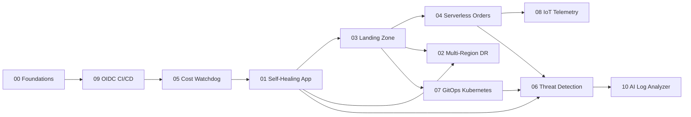

# Roadmap — 10 Multi-Cloud Projects (AWS · Azure · GCP)

> Goal: build 10 portfolio-grade cloud projects, each implemented on **AWS, Azure and GCP** with
> Terraform, CI/CD, architecture diagrams, and a cross-cloud comparison you can talk through in an interview.

---

## 1. The strategy: design once, build three times

Building 30 separate projects from scratch would take years and teach you less. Instead, each project
follows the same four steps:

| Step | What you do | Share of the project's time |
|---|---|---|
| **1. Design (cloud-neutral)** | Problem, requirements, cloud-neutral architecture diagram, app code, tests, load tests | ~20% |
| **2. Build on the lead cloud** | Full implementation, learn the concepts deeply | ~40% |
| **3. Port to the other two clouds** | Same design and app code, new `infra/<cloud>/` Terraform + small adapter code | ~30% (ports are much faster than the first build) |
| **4. Compare** | `docs/comparison.md`: what was easier/harder, cost, limits, which cloud you'd pick and why | ~10% |

Step 4 is the most valuable part for interviews. Anyone can follow a tutorial on one cloud; being able
to say *"Pub/Sub has no dead-letter queue as a separate resource — it's a subscription setting that
forwards to another topic, unlike SQS"* shows real understanding.

### Which cloud leads?
The project guides are written **Azure-first**, so Azure is the default lead cloud, then AWS, then GCP.
If you're stronger on AWS, swap the order: lead with what you know for speed, or with what you don't for
learning. Whatever you pick, keep the order consistent so the comparisons stay fair.

### Keep the code portable
- **Application code** lives once in `src/` and talks to the cloud through a thin adapter
  (e.g. `queue.send()` implemented for SQS, Service Bus and Pub/Sub). This is the *ports and adapters*
  (hexagonal architecture) pattern — a great interview topic in itself.
- **Infrastructure** differs per cloud: `infra/aws/`, `infra/azure/`, `infra/gcp/`, but each exposes
  the **same input variables and outputs**, so the pipeline and tests don't care which cloud they target.
- Prefer cloud-neutral tooling where it's realistic: containers, OpenTelemetry, Grafana, k6, ArgoCD
  (see the [service map](docs/multi-cloud-service-map.md#3-cloud-neutral-tools-used-across-this-repo)).
- Don't force it: use managed, cloud-specific services where that's what a real team would do. Explain
  the lock-in trade-off in the comparison.

---

## 2. Build order

| Step | Project | Why here | Est. time* |
|---|---|---|---|
| 0 | [Foundations](docs/00-foundations.md) + [Service map](docs/multi-cloud-service-map.md) | Accounts on all three clouds, IAM models, networking, Terraform | 3–4 wks |
| 1 | [09 · Secrets-Free CI/CD with OIDC](projects/09-secrets-free-cicd-oidc/) | One pipeline that can deploy to all three clouds — every later project uses it | 2 wks |
| 2 | [05 · Cost Watchdog](projects/05-cost-watchdog/) | Protects your wallet on three bills at once | 3 wks |
| 3 | [01 · Self-Healing Web App](projects/01-self-healing-web-app/) | First real app: compute, health checks, monitoring, automation | 4 wks |
| 4 | [03 · Zero-Trust Landing Zone](projects/03-zero-trust-landing-zone/) | Networking + identity + guardrails that later projects deploy into | 5–6 wks |
| 5 | [04 · Serverless Order Pipeline](projects/04-serverless-order-pipeline/) | Messaging, functions, NoSQL, event-driven design | 4 wks |
| 6 | [08 · Real-Time IoT Telemetry Pipeline](projects/08-iot-telemetry-pipeline/) | Streaming data; builds on event-driven concepts | 4 wks |
| 7 | [02 · Multi-Region Disaster Recovery](projects/02-multi-region-dr/) | Takes project 01 into two regions per cloud | 4–5 wks |
| 8 | [07 · GitOps Kubernetes Platform with ArgoCD](projects/07-gitops-kubernetes-argocd/) | AKS + EKS + GKE managed by one ArgoCD | 5–6 wks |
| 9 | [06 · Cloud Threat Detection (SIEM)](projects/06-cloud-threat-detection/) | Needs logs from earlier projects on all three clouds | 4 wks |
| 10 | [10 · AI-Powered Log Analyzer](projects/10-ai-log-analyzer/) | Capstone: one analyzer, three LLM providers, logs from everything | 4–5 wks |

\* Assumes ~10–12 hours/week. **Total: about 12 months.** One project on all three clouds takes
roughly 2× a single-cloud build, not 3×, because the design and app code are reused.

**Short on time?** Build all 10 on the lead cloud first (~6 months), then go back and port. Ports of
projects 09, 05, 01, 04 and 07 give the best multi-cloud story for the effort.

---

## 3. Two kinds of multi-cloud project

Know the difference — interviewers do.

1. **Portable (same design on each cloud)** — every project. Shows you understand the patterns
   behind the products.
2. **Truly multi-cloud (one system spanning clouds)** — the stretch goal in some projects, and the most
   impressive thing in this repo:

| Project | One system across all three clouds |
|---|---|
| 09 | One GitHub workflow authenticates to AWS, Azure and GCP with OIDC — zero secrets on any cloud |
| 05 | One weekly report combining spend from all three bills, with one tagging/labelling standard |
| 07 | One ArgoCD instance managing EKS, AKS and GKE clusters from one Git repo |
| 06 | One SIEM ingesting CloudTrail, Azure Activity Log and GCP Audit Logs |
| 10 | One analyzer that can use Bedrock, Azure OpenAI or Vertex AI and reads logs from all three |
| 02 | Stretch: DR *between* clouds (e.g. primary on Azure, standby on AWS) and why most companies don't do it |

---

## 4. Phases & milestones

### Phase 0 — Foundations (weeks 1–4)
- [ ] Create accounts on all three clouds and **set billing alerts on day 1** on each
- [ ] Install: AWS CLI, Azure CLI, gcloud CLI, Terraform, Git, Docker, VS Code
- [ ] Work through [docs/00-foundations.md](docs/00-foundations.md) and the [service map](docs/multi-cloud-service-map.md)
- [ ] Deploy and destroy a storage bucket on each cloud with Terraform
- **Milestone:** you can explain how AWS accounts, Azure subscriptions and GCP projects compare, and how IAM differs on each.

### Phase 1 — Delivery & guardrails (weeks 5–9) · Projects 09, 05
- **Milestone:** a push to `main` deploys to any of the three clouds with **zero stored secrets**, and every account/subscription/project has budget alerts and auto-shutdown.

### Phase 2 — Core architecture (weeks 10–19) · Projects 01, 03
- **Milestone:** a self-healing app on App Service, ECS Fargate and Cloud Run, inside a landing zone with guardrails on each cloud.

### Phase 3 — Event-driven & data (weeks 20–27) · Projects 04, 08
- **Milestone:** two async pipelines per cloud, and a comparison of Service Bus vs SQS vs Pub/Sub that you can explain from experience.

### Phase 4 — Resilience & platforms (weeks 28–38) · Projects 02, 07
- **Milestone:** measured RTO/RPO on each cloud; one ArgoCD deploying to EKS, AKS and GKE.

### Phase 5 — Security & AI (weeks 39–48) · Projects 06, 10
- **Milestone:** one SIEM detecting attacks across three clouds; an LLM analyzer working with three providers.

---

## 5. Definition of "done" for every project

- [ ] `README.md` — problem, cloud-neutral design, architecture diagrams, how to deploy/destroy on each cloud, cost per cloud, lessons learned
- [ ] `docs/architecture-<cloud>.png` for each cloud + one cloud-neutral diagram — see [diagram tips](docs/diagrams.md)
- [ ] `infra/aws/`, `infra/azure/`, `infra/gcp/` — Terraform with the **same variables and outputs**
- [ ] `src/` — app code shared across clouds, cloud-specific code isolated in adapters
- [ ] GitHub Actions workflow with a `cloud` input (`aws | azure | gcp`) deploying via OIDC
- [ ] `docs/comparison.md` — table comparing the three implementations (effort, cost, limits, developer experience) + your recommendation
- [ ] A **demo** per cloud (screenshots or a short recording)
- [ ] An **interview story** ([docs/interview-guide.md](docs/interview-guide.md))
- [ ] All resources **destroyed** on all three clouds after the demo

---

## 6. Cost rules (read before every project)

1. **Budget alerts on every cloud** before deploying anything — AWS Budgets, Azure Cost Management, GCP Cloud Billing budgets ([project 05](projects/05-cost-watchdog/) automates this).
2. Use each cloud's new-account credits and free tiers, one cloud at a time — don't burn all three trials in month one. Check current free-tier terms; they change.
3. Tag/label everything: `project`, `owner`, `env`, `autoshutdown`. (GCP **labels** must be lowercase — use lowercase everywhere so one standard works on all three.)
4. **Deploy → demo → screenshot → destroy**, on one cloud at a time.
5. Expensive on every cloud: managed firewalls, Kubernetes nodes, NAT gateways (AWS bills per hour + per GB), load balancers, streaming/stream-processing units, SIEM ingestion, LLM tokens, cross-region data transfer. Each project lists its cost hot-spots per cloud.
6. Price it first: [AWS Pricing Calculator](https://calculator.aws/), [Azure Pricing Calculator](https://azure.microsoft.com/pricing/calculator/), [Google Cloud Pricing Calculator](https://cloud.google.com/products/calculator).

---

## 7. Certifications that line up with this roadmap (optional)

Pick **one associate cert per cloud**, plus one professional in your strongest cloud.

| After phase | AWS | Azure | GCP | Cloud-neutral |
|---|---|---|---|---|
| 0–1 | Cloud Practitioner | AZ-900 | Cloud Digital Leader | Terraform Associate |
| 2–3 | **Solutions Architect – Associate** | **AZ-104** Administrator | **Associate Cloud Engineer** | |
| 4 | Solutions Architect – Professional | AZ-305 Solutions Architect | Professional Cloud Architect | CKA / CKAD |
| 5 | Security – Specialty | SC-200 Security Operations | Professional Cloud Security Engineer | |
| — | DevOps Engineer – Professional | AZ-400 DevOps | Professional Cloud DevOps Engineer | |

Realistic target: the three associate certs + Terraform Associate alongside this repo.
