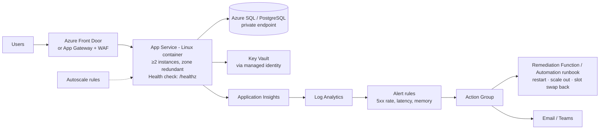

# 01 · Self-Healing Web App on Azure

> **Build order: #3** · Difficulty ⭐⭐ · ~2 weeks · Cost: ≈ $15–60/month while running (destroy after demo)

## The problem
Apps fail in boring ways: memory leaks, hung processes, a bad instance, a traffic spike. At 3 a.m. you
don't want a human restarting things — you want the platform to detect, recover, and tell you afterwards.

## What you'll build
A containerised web API that automatically recovers from failures at three levels:
1. **Instance level** — health checks remove and replace unhealthy instances.
2. **Capacity level** — autoscale adds instances under load and removes them after.
3. **Application level** — alert-driven automation (restart, scale out, roll back a bad deployment slot).

The app has built-in **chaos endpoints** (`/chaos/crash`, `/chaos/leak-memory`, `/chaos/cpu`) so you can
*prove* it heals during a demo.

## Skills & concepts you'll learn

### Compute choices on Azure
| Option | When to use |
|---|---|
| **App Service** (Web App for Containers) | Simplest managed web hosting; built-in health check, auto-heal, slots, autoscale. **Start here.** |
| **VM Scale Sets (VMSS)** | Full OS control; *automatic instance repairs* via Application Health extension. Good stretch version. |
| **Container Apps** | Serverless containers, scale to zero, KEDA-based scaling |
| **AKS** | Full Kubernetes — project 07 |

### Health checks & probes
- **Liveness** ("is the process alive?") vs **readiness** ("can it serve traffic? are DB connections OK?").
- App Service **Health check** pings `/healthz`; unhealthy instances are taken out of rotation and eventually replaced.
- App Service **Auto-Heal**: rules like "recycle if memory > X or if > N slow requests in Y minutes".
- Design the endpoint carefully: a health check that calls a failing database makes *all* instances look unhealthy at once (a classic outage cause — great interview point).

### Autoscaling
- Scale **out/in** (more instances) vs **up/down** (bigger instances).
- Metric-based rules (CPU > 70% for 10 min → +1) and schedule-based rules; **cool-down** periods to avoid flapping.
- Minimum of 2 instances + **zone redundancy** = survive a datacentre failure.

### Observability (Azure Monitor deep dive)
- **Application Insights**: requests, dependencies, exceptions, live metrics, availability (synthetic) tests from multiple locations.
- **OpenTelemetry** instrumentation in your app (the modern, vendor-neutral way).
- **Alert types**: metric alerts, log (KQL) alerts, availability-test alerts; severity levels; stateful alerts that auto-resolve.
- **SLI / SLO**: e.g. "99.9% of requests succeed in < 500 ms over 30 days". Build a workbook showing it.

### Automated remediation
- Action Groups → Azure Function or Automation runbook that restarts the app, scales out, or swaps the deployment slot back.
- **Deployment slots**: deploy to `staging`, warm up, swap into production; swap back = instant rollback.
- Idempotent and rate-limited remediation (don't restart in an infinite loop!).

### Secure app basics
- Managed identity to Key Vault and the database (no connection-string passwords).
- HTTPS only, minimum TLS 1.2, private endpoint for the database, WAF in front.

### Containers
- Write a small API (Python FastAPI or Node Express), `Dockerfile`, push to **ACR**, App Service pulls with managed identity (`AcrPull` role).

## Build plan
1. App: API + `/healthz` + `/ready` + chaos endpoints + OpenTelemetry. Run locally in Docker.
2. Terraform: RG, ACR, App Service plan (P1v3, zone redundant, 2+ instances), Web App, App Insights, Log Analytics, Key Vault, database with private endpoint.
3. CI/CD (reuse project 09): build image → push to ACR → deploy to `staging` slot → smoke test → swap.
4. Health check + auto-heal + autoscale rules.
5. Alerts (5xx rate, p95 latency, availability test) → Action Group → remediation Function.
6. **Chaos demo**: hit `/chaos/crash` on one instance → watch traffic shift → instance replaced. Load test with **Azure Load Testing**, `k6` or `hey` → watch autoscale. Record it.
7. Workbook/dashboard with SLO, instance count, and remediation events.

## Cost hot-spots
- Zone-redundant Premium App Service plan needs multiple instances — the main cost. Use a single-instance B1/S1 while developing, switch to P1v3 ×2 (or ×3) for the demo, then destroy.
- Front Door / App Gateway WAF add a fixed monthly fee — add them last.

## Stretch goals
- Rebuild on **VMSS** with automatic instance repairs and compare.
- Use **Azure Chaos Studio** for controlled fault injection.
- Blue/green with traffic splitting (send 10% to the new slot first).

## Interview talking points
- The three layers of self-healing and *which signal* triggers each.
- "Why not just restart on high CPU?" → CPU can be legitimate load; scale on load, restart on unhealthiness.
- Measured numbers: time to detect, time to recover, instances during the load test.
