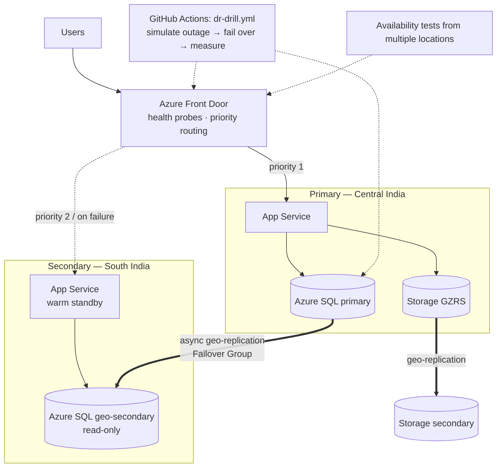

# 02 · Multi-Region Disaster Recovery Failover

> **Build order: #7** · Difficulty ⭐⭐⭐⭐ · ~2–3 weeks · Cost: ≈ $40–150/month while running (two regions — destroy after the drill)

## The problem
Availability zones protect against a datacentre failure, but not a whole-region outage (rare, but it
happens — and regulators and customers ask "what's your DR plan?"). Without a tested plan, DR is a
document nobody trusts.

## What you'll build
Project 01's web app deployed in **two regions** with replicated data, global traffic routing, and an
automated, **measured** failover drill. The deliverable isn't just infrastructure — it's a DR runbook with
real RTO/RPO numbers.

## Skills & concepts you'll learn

### DR vocabulary (memorise these)
| Term | Meaning |
|---|---|
| **RTO** — Recovery Time Objective | How long can we be down? (e.g. 15 min) |
| **RPO** — Recovery Point Objective | How much data can we lose? (e.g. 5 s of writes) |
| **High availability vs DR** | HA = survive component/zone failure automatically; DR = recover from region-level disaster |
| **Failover / failback** | Move to secondary / return to primary |
| **Planned vs forced failover** | Planned = no data loss (syncs first); forced = immediate, possible data loss |
| **Split brain** | Both regions think they're primary and accept writes — must be prevented |

### DR strategies (cost ↔ RTO trade-off)
1. **Backup & restore** — cheapest, RTO hours.
2. **Pilot light** — data replicated, minimal compute off/small in secondary.
3. **Warm standby** — scaled-down full stack running in secondary. ← *build this*
4. **Active-active** — both regions serve traffic; hardest (data consistency), lowest RTO.

Be able to explain which strategy fits which business — this is a classic architect question.

### Global traffic routing
- **Azure Front Door** (L7, global anycast, WAF, caching, health probes) vs **Traffic Manager** (DNS-based, any protocol, slower failover because of DNS TTL caching).
- Routing methods: priority (active-passive), weighted, latency/performance.
- Health probe design: probe a `/healthz` endpoint that checks the region's critical dependencies.

### Data replication — the hard part
- **Azure SQL active geo-replication & failover groups**: async replication, read-only secondary, a listener endpoint that follows the primary, automatic vs customer-managed failover policy.
- **Cosmos DB** multi-region writes (alternative path; conflict resolution).
- **Storage redundancy**: LRS / ZRS / GRS / GZRS / RA-GZRS and customer-initiated failover.
- Asynchronous replication ⇒ RPO > 0. Understand **why**: synchronous replication across hundreds of km adds latency to every write.
- **Region pairs** and data-residency considerations.

### Stateless apps & configuration
- Region-specific config (connection strings point at the *failover group listener*, not a server).
- Secrets in Key Vault per region; container images available in both regions (**ACR geo-replication**, Premium tier).
- Session state not stored in-memory.

### Infrastructure as code for multiple regions
- One Terraform module, instantiated per region with `for_each` over a `regions` map.
- Parameterising region, CIDRs and priority. Avoid hidden single-region dependencies (a single Key Vault, a single Log Analytics workspace…).

### Testing DR (most teams skip this — you won't)
- **Game day / DR drill**: scripted outage (stop primary app, block traffic with a NSG/access restriction, or use **Azure Chaos Studio**).
- Measure RTO: timestamp when errors start vs when the secondary serves successfully (a script hitting the endpoint every second).
- Measure RPO: write sequential records continuously; after failover, find the last record present.
- **Failback** procedure and re-protecting replication.
- Write a **runbook**: who decides, what commands, how to verify, how to communicate.

## Build plan
1. Refactor project 01's Terraform into a `region` module; deploy it to two regions.
2. Azure SQL server in each region + **failover group**; app uses the listener endpoint.
3. Storage GZRS, ACR geo-replication, Key Vault per region.
4. Front Door with priority routing and health probes.
5. Write `scripts/probe.sh` (requests/sec + timestamps) and `scripts/writer.py` (sequential writes for RPO).
6. `dr-drill.yml` workflow: start probes → simulate primary outage → trigger SQL failover → wait for Front Door to shift → record RTO/RPO → upload results as an artifact.
7. Failback drill. Write `docs/dr-runbook.md` with real numbers and a timeline graph.

## Cost hot-spots
- Everything ×2 regions. Use smallest tiers that support the features: SQL General Purpose serverless (auto-pause doesn't work on geo-secondaries — note this), App Service S1 in secondary.
- Front Door Standard has a monthly base fee. ACR geo-replication requires Premium.
- Run the drill in a single afternoon, then `terraform destroy`.

## Stretch goals
- Active-active with Cosmos DB multi-region writes.
- Traffic Manager version and compare failover time vs Front Door.
- Automate failover decision with an Azure Monitor alert → Function (and discuss why many teams keep a *human* in the loop for the regional failover decision).
- Backup & restore strategy (Azure Backup, point-in-time restore) for *data corruption*, which replication doesn't protect against.

## Interview talking points
- "Our RTO was 92 s and RPO under 5 s, measured, not estimated."
- Why replication isn't a backup (corruption/ransomware replicates too).
- Why you chose warm standby, and what active-active would cost in money and complexity.
- How Front Door decides a region is unhealthy and how long it takes.
