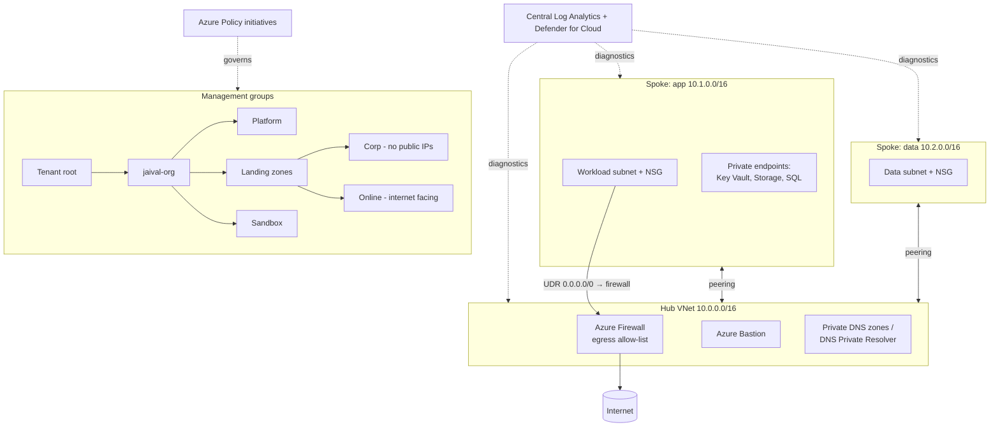

# 03 · Zero-Trust Landing Zone with Terraform

> **Build order: #4** · Difficulty ⭐⭐⭐⭐ · ~3 weeks · Cost: ≈ $5/month without firewall; Azure Firewall adds a lot (deploy it for the demo only)

## The problem
When a company moves to Azure, every team creating subscriptions and networks their own way leads to
public databases, flat networks, and nobody knowing who has access to what. A **landing zone** is the
pre-built, governed foundation that workloads "land" in.

## What you'll build
A Terraform-deployed, scaled-down **enterprise-scale landing zone** following *zero-trust* principles:
management-group hierarchy, Azure Policy guardrails, hub-and-spoke networking with centralised egress
inspection, private-only PaaS access, and identity-based access control. Later projects (02, 04, 07)
deploy their workloads into spokes of this landing zone.

## Skills & concepts you'll learn

### Zero trust — the principles
1. **Verify explicitly** — authenticate and authorise every request (identity, device, location).
2. **Use least-privilege access** — just-in-time, just-enough access.
3. **Assume breach** — segment networks, encrypt everything, log everything, so one compromise can't spread.

Network location is no longer trust: being "inside the VNet" doesn't make a request safe.

### Cloud Adoption Framework (CAF) landing zones
- **Management group hierarchy** (Platform / Landing Zones / Sandbox / Decommissioned) and why policies are assigned high up and inherited.
- **Platform landing zone** (shared: connectivity, identity, management) vs **application landing zones** (workloads).
- **Subscription vending**: new projects get a pre-configured subscription/spoke.
- Know **Azure Verified Modules (AVM)** — Microsoft's official Terraform/Bicep modules. Build key pieces yourself to learn, then mention you'd use AVM in production.

### Azure Policy (governance as code)
- **Definitions** → grouped into **initiatives** → **assigned** at a scope, with **exemptions**.
- Effects: `audit`, `deny`, `modify`, `append`, `deployIfNotExists` (DINE — auto-deploys diagnostics, for example), `auditIfNotExists`.
- Guardrails to implement: allowed regions; deny public IPs in Corp; deny storage with public access; require private endpoints; require tags; enforce diagnostic settings → central Log Analytics; require HTTPS/TLS 1.2.
- **Remediation tasks** for existing non-compliant resources; the compliance dashboard.

### Networking (the core of this project)
- **Hub-and-spoke** topology, **VNet peering** (non-transitive! spoke-to-spoke goes through the hub firewall).
- **User-Defined Routes (UDRs)**: force `0.0.0.0/0` through the firewall = **forced tunnelling / egress control**.
- **Azure Firewall**: network rules, application (FQDN) rules, threat intelligence; *Basic* vs *Standard* vs *Premium* (TLS inspection, IDPS).
- **NSGs** + **Application Security Groups** for micro-segmentation inside spokes.
- **Private Endpoints + Private DNS zones** (`privatelink.vaultcore.azure.net`, …) — and the DNS problems you'll hit.
- **Azure Bastion** — RDP/SSH without public IPs on VMs.
- Optional: **Virtual WAN** as the managed alternative to hub-and-spoke.

### Identity & privileged access
- RBAC assigned to **groups**, never individuals; custom roles.
- **Privileged Identity Management (PIM)** — just-in-time role activation with approval (needs Entra ID P2; document the design if you don't have it).
- **Conditional Access** (MFA, compliant device) — concept level.
- **Managed identities** everywhere; Key Vault with RBAC authorisation (not access policies).

### Security posture
- **Microsoft Defender for Cloud**: secure score, recommendations, regulatory compliance (e.g. Microsoft cloud security benchmark).
- Central logging: activity logs and diagnostic settings → one Log Analytics workspace (also feeds project 06).

### Advanced Terraform
- Splitting into **layers** with separate state: `management-groups` → `policy` → `connectivity` (hub) → `spokes`.
- Reusable **modules** (`modules/spoke`), `for_each` to stamp multiple spokes from a map.
- `terraform_remote_state` or data sources to pass hub outputs to spokes.
- **Policy-as-code testing**: deploy something that *should* be denied and assert the deny in CI.

## Build plan
1. Design: draw the MG hierarchy and IP address plan (no overlapping CIDRs!) **before** writing code.
2. Management groups + move your subscription under `Landing zones/Corp`.
3. Policy initiative (5–10 guardrails) assigned at `jaival-org`; verify a public storage account is **denied**.
4. Hub: VNet, Firewall (Basic tier to save cost), Bastion, Private DNS zones, central Log Analytics.
5. Spoke module: VNet, subnets, NSGs, UDR → firewall, peering to hub. Instantiate two spokes.
6. Test workload: VM (no public IP) + Key Vault & Storage via private endpoints. Prove: VM reaches Key Vault privately, Key Vault is unreachable from the internet, VM egress only works for allow-listed FQDNs.
7. Defender for Cloud + secure score screenshot; firewall logs in Log Analytics (KQL: denied connections).
8. Document the decisions in short **ADRs** (Architecture Decision Records), e.g. "Why hub-spoke instead of Virtual WAN".

## Cost hot-spots
- **Azure Firewall** is the big one (hundreds of $/month even on Basic). Deploy the hub without it while developing, add it for testing/demo, then destroy. Toggle with a variable: `enable_firewall = false`.
- Bastion also has an hourly cost — Developer SKU is cheaper/free in supported regions; destroy when not in use.
- Defender for Cloud paid plans — use the free foundational CSPM tier.

## Stretch goals
- Subscription vending module.
- **DDoS protection** design notes, **Azure Firewall Premium** IDPS.
- Policy compliance report posted to PRs.
- Re-implement one layer in **Bicep** and compare.

## Interview talking points
- Explain the three zero-trust principles with a concrete control for each.
- "How do you stop a developer from creating a public database?" → `deny` policy at the management-group level; they can't bypass it with Contributor rights.
- "Why does private endpoint DNS break so often?" → explain Private DNS zones, VNet links, and custom DNS forwarding.
- Show the IP plan and explain why you left room for growth.
