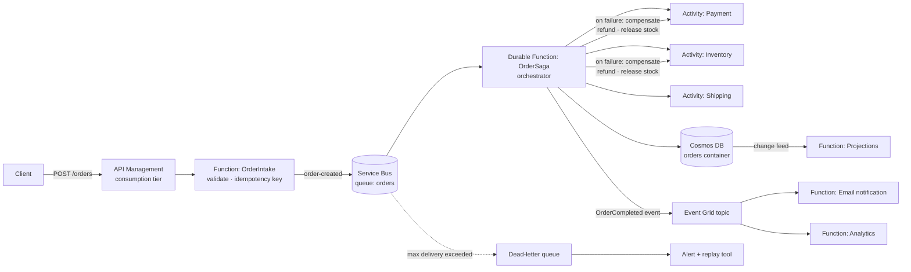

# 04 · Serverless Event-Driven Order Pipeline

> **Build order: #5** · Difficulty ⭐⭐⭐ · ~2 weeks · Cost: ≈ $1–15/month (mostly Service Bus Standard + Cosmos DB)

## The problem
A synchronous order flow (API → payment → inventory → email, all in one request) is slow and fragile: if
the email service is down, the whole order fails. Spikes (a sale) overload everything at once.

## What you'll build
An e-commerce order backend where services communicate through **messages and events** instead of direct
calls. Each step scales, fails, and retries independently, and nothing is lost.

## Skills & concepts you'll learn

### Event-driven architecture
- **Command** ("PlaceOrder" — do this) vs **event** ("OrderPlaced" — this happened).
- **Loose coupling**: producers don't know who consumes.
- **Asynchronous processing**: return `202 Accepted` + order id immediately, process in the background, let the client poll `GET /orders/{id}` (or push via SignalR/webhook).
- **Eventual consistency** and why it's fine for most business flows.

### Azure messaging services — know which to use when
| Service | Model | Use it for |
|---|---|---|
| **Service Bus** | Message broker (queues, topics/subscriptions) | Business transactions: ordering (sessions), at-least-once, dead-lettering, transactions, duplicate detection |
| **Event Grid** | Event routing (push, pub/sub) | Reacting to *something happened* — fan-out, Azure resource events |
| **Event Hubs** | Streaming log (partitioned, high throughput) | Telemetry/millions of events per second — project 08 |
| **Storage Queues** | Simple queue | Cheap, basic background work |

This comparison is one of the most common Azure interview questions.

### Reliability patterns
- **At-least-once delivery** → consumers must be **idempotent** (processing the same message twice has no extra effect). Use an idempotency key / dedupe table.
- **Retries with exponential backoff**, **poison messages** and the **dead-letter queue (DLQ)**; a tool to inspect and replay DLQ messages.
- **Peek-lock** vs receive-and-delete.
- **Saga pattern** for distributed transactions: no global transaction across payment, inventory and shipping, so each step has a **compensating action** (refund, release stock).
- **Transactional outbox** (write to DB and publish an event reliably) — at least explain it.

### Azure Functions — beyond the basics
- Triggers/bindings: HTTP, Service Bus, Event Grid, Cosmos DB change feed.
- **Durable Functions**: orchestrator + activity functions, function chaining, fan-out/fan-in, timers, human-interaction pattern; orchestrators must be **deterministic** (why?).
- Hosting: **Flex Consumption** (scale to zero, per-execution billing, VNet integration) vs Premium (no cold start).
- Cold starts and how to mitigate them.
- Identity-based connections (`ServiceBusConnection__fullyQualifiedNamespace`) — no connection strings.

### Cosmos DB (NoSQL)
- Containers, items, **partition key** choice (e.g. `/customerId`) — the most important design decision; hot partitions.
- Request Units (RUs), serverless vs provisioned throughput.
- Consistency levels (strong → eventual) and their trade-offs.
- **Change feed** to build read models (CQRS-lite).

### API Management (APIM)
- Gateway in front of Functions: rate limiting, API keys/subscriptions, JWT validation, request transformation, versioning, developer portal.

### Testing & observability for async systems
- Correlation IDs across messages; distributed tracing in Application Insights (end-to-end transaction view).
- Load test a spike (e.g. 5,000 orders in a minute) and watch the queue absorb it — **queue-based load levelling**.

## Build plan
1. Model: order states (`Pending → Paid → Reserved → Shipped` / `Failed → Compensated`) as a state diagram.
2. Terraform: Service Bus (queue + DLQ settings), Event Grid topic, Cosmos DB (serverless), Function App (Flex Consumption) with managed identity + RBAC data roles, App Insights, APIM (consumption).
3. `OrderIntake` HTTP function with validation + idempotency key → Service Bus.
4. Durable orchestrator with payment/inventory/shipping activities (mock services; inject random failures with a config flag).
5. Compensation logic + tests for each failure branch.
6. Event Grid fan-out to notification + analytics functions; change-feed projection.
7. DLQ alert + `replay-dlq` script. Load test. Workbook: orders/min, queue depth, failure rate, end-to-end latency.

## Cost hot-spots
Low. Service Bus **Standard** tier (needed for topics) has a small base fee; Cosmos DB serverless and Functions are pay-per-use. APIM consumption tier is pay-per-call. Avoid APIM Developer/Standard tiers (fixed monthly cost).

## Stretch goals
- Service Bus **sessions** for strict per-customer ordering.
- Replace mocks with real services in Container Apps.
- Contract testing of event schemas; publish events as **CloudEvents**.
- Deploy into a spoke of the project 03 landing zone with private endpoints.

## Interview talking points
- Service Bus vs Event Grid vs Event Hubs — when and why.
- "What happens if payment succeeds but inventory fails?" → saga + compensation.
- "How do you avoid charging a customer twice?" → idempotency keys + duplicate detection.
- Numbers from your load test: peak orders/minute, queue depth, time to drain.
