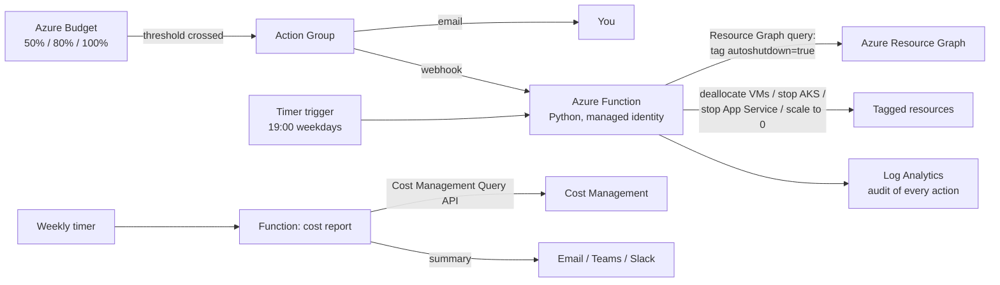

# 05 · Cloud Cost Watchdog with Auto-Shutdown

> **Build order: #2** · Difficulty ⭐⭐ · ~1–2 weeks · Cost: ≈ $0–5/month

## The problem
Cloud bills grow quietly: a forgotten VM over the weekend, a dev AKS cluster left running, a resource
nobody owns. Budgets alone only *notify* — they don't *act*.

## What you'll build
A watchdog that (a) alerts as spend approaches budget, (b) automatically stops/deallocates tagged
non-production resources when a threshold is crossed or outside working hours, (c) finds untagged and
orphaned resources, and (d) sends a weekly cost report. Build it early — it protects your wallet for
the other 8 projects.



## Skills & concepts you'll learn

### FinOps fundamentals
- **FinOps** = making engineering teams accountable for cloud spend. Phases: *Inform → Optimise → Operate*.
- **Cost allocation with tags** (`owner`, `project`, `env`, `costcenter`). Untagged = unaccountable.
- Common waste: idle compute, oversized SKUs, unattached disks, unused public IPs, old snapshots, non-prod running 24/7 (168 h/week vs ~50 working hours ≈ 70% saving).
- Reserved instances / savings plans vs pay-as-you-go vs spot VMs — know when each fits.

### Azure Cost Management + Budgets
- Budgets at subscription or resource-group scope, with **actual** and **forecasted** thresholds.
- Budgets → **Action Groups** → email / webhook / Function / Logic App / Automation runbook.
- **Cost Management Query API** for programmatic reports; **cost exports** to a storage account for history.
- Note: cost data has a delay (hours, not seconds) — the watchdog is a guardrail, not a hard cap.

### Azure Resource Graph
- Query *every* resource across subscriptions in seconds with KQL:
  ```kusto
  Resources
  | where type =~ 'microsoft.compute/virtualmachines'
  | where tags['autoshutdown'] =~ 'true'
  | project name, resourceGroup, location, tags
  ```
- Find orphans: disks where `managedBy` is empty, public IPs with no `ipConfiguration`.

### Azure Functions (your first serverless code)
- Triggers (timer, HTTP) and bindings; the **Flex Consumption** plan (scale to zero, pay per execution).
- CRON expressions for timer triggers (`0 0 19 * * 1-5` = 19:00 Mon–Fri; Functions use 6 fields incl. seconds).
- Using the Azure SDK for Python (`azure-identity`, `azure-mgmt-compute`, `azure-mgmt-resourcegraph`) with `DefaultAzureCredential` → **managed identity** in Azure, your `az login` locally.
- Custom RBAC role: only `Microsoft.Compute/virtualMachines/deallocate/action`, `.../start/action`, `read` — least privilege in practice.

### Azure Policy (light introduction — goes deep in project 03)
- Policy to **require** the `owner` and `env` tags, or **inherit** tags from the resource group.
- Effects: `audit`, `deny`, `modify`.

### Alternatives worth knowing (and why you chose Functions)
- **Azure Automation** runbooks (PowerShell) + Start/Stop VMs v2 — older, but common in enterprises.
- **Logic Apps** — low-code, good for notifications.
- Being able to say *why* you picked one is the interview value.

## Build plan
1. Tag strategy doc + Azure Policy requiring tags.
2. Budget (Terraform `azurerm_consumption_budget_subscription`) with 50/80/100% + forecast alert → Action Group (email).
3. Function app with managed identity + custom role. Timer function: Resource Graph query → deallocate tagged VMs / stop App Services / stop AKS.
4. Webhook function triggered by the 100% budget alert → emergency stop of all `env=dev` resources.
5. "Opt-out" tag: `autoshutdown=false` or `keepalive-until=2026-12-01`.
6. Weekly report function: spend by `project` tag, top 5 costs, orphaned resources → email/Teams.
7. Log every action to Log Analytics; build a workbook showing "hours saved / estimated $ saved".

## Cost hot-spots
Nearly free. Function executions fall within free grants; Log Analytics ingestion is tiny.

## Stretch goals
- Auto-**start** at 08:00 for resources tagged `schedule=office-hours`.
- Anomaly detection: compare today's spend with the 7-day average and alert on > 2× spikes.
- Rightsizing suggestions from **Azure Advisor** API included in the weekly report.
- Slack/Teams interactive button: "Keep running for 4 more hours".

## Interview talking points
- Quantify: "Dev resources now run ~50 h/week instead of 168 h — about 70% compute saving."
- Safety: least-privilege custom role, opt-out tags, audit trail of every shutdown.
- Limitations: cost data latency → budgets aren't a hard cap; that's why the schedule-based shutdown exists too.
