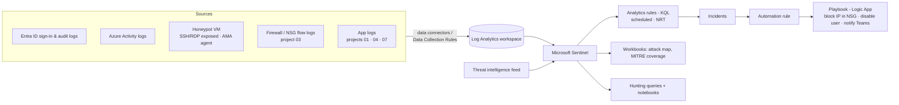

# 06 · Threat Detection with Microsoft Sentinel

> **Build order: #9** · Difficulty ⭐⭐⭐ · ~2 weeks · Cost: free trial period on a new workspace, then pay per GB ingested — keep ingestion small

## The problem
Logs are scattered across sign-ins, Azure activity, VMs, firewalls and apps. Attackers are noisy only if
someone is listening. A security operations centre (SOC) needs one place to **collect, detect,
investigate and respond**.

## What you'll build
A small SOC on **Microsoft Sentinel** (a cloud SIEM + SOAR) that ingests logs from your earlier
projects and a deliberately exposed "honeypot" VM, detects real attack patterns with custom KQL rules
mapped to **MITRE ATT&CK**, and responds automatically with playbooks.



## Skills & concepts you'll learn

### Security operations fundamentals
- **SIEM** (Security Information & Event Management: collect + correlate + detect) vs **SOAR** (Security Orchestration, Automation & Response: automated playbooks).
- The SOC workflow: **detect → triage → investigate → contain → eradicate → recover → lessons learned** (NIST incident-response lifecycle).
- **True/false positives**, alert fatigue, tuning.
- **MITRE ATT&CK**: tactics (the *why*: Initial Access, Persistence, Privilege Escalation, Lateral Movement, Exfiltration…) and techniques (the *how*, e.g. T1110 Brute Force). Map every detection to a technique.
- **Indicators of compromise (IOCs)** vs **behavioural detections**.

### Microsoft Sentinel
- Built on a **Log Analytics workspace**; Sentinel is now operated primarily through the **Microsoft Defender portal** (unified SecOps) — learn the current experience.
- **Data connectors** & **Content Hub** solutions; **Azure Monitor Agent (AMA)** with **Data Collection Rules (DCRs)** for VMs (including ingestion-time filtering to cut cost).
- **Analytics rules**: scheduled, near-real-time (NRT), Microsoft security (from Defender alerts), anomaly, fusion; entity mapping (IP, account, host) so incidents link related alerts.
- **Incidents**, investigation graph, **automation rules** and **playbooks** (Logic Apps).
- **Watchlists** (e.g. known admin IPs, VIP users), **threat intelligence** indicators.
- **Workbooks** for dashboards; **hunting** queries; **UEBA** (user & entity behaviour analytics).
- Table plans and cost: Analytics vs Basic/Auxiliary logs, retention, commitment tiers.

### KQL for detection engineering (core skill)
Brute force against your honeypot (MITRE T1110):
```kusto
Syslog
| where TimeGenerated > ago(1h)
| where Facility in ("auth", "authpriv") and SyslogMessage has "Failed password"
| extend SourceIP = extract(@"from (\d{1,3}(?:\.\d{1,3}){3})", 1, SyslogMessage)
| summarize Attempts = count(), Users = make_set(extract(@"for (invalid user )?(\S+)", 2, SyslogMessage))
    by SourceIP, bin(TimeGenerated, 10m)
| where Attempts > 20
```
Other detections to write:
- Impossible travel / sign-ins from new countries (`SigninLogs`)
- Role assignment of `Owner` outside a change window (`AzureActivity`)
- Key Vault secret mass-reads (`AzureDiagnostics` / Key Vault logs)
- Mass resource deletion; disabling diagnostic settings (defence evasion)
- Successful login *after* many failures from the same IP

KQL operators to master: `where, project, extend, summarize, bin, join, union, make_set, arg_max, parse, extract, mv-expand, let, materialize, geo_info_from_ip_address`.

### Detection-as-code
- Store analytics rules as code (ARM/Bicep/Terraform `azurerm_sentinel_alert_rule_scheduled` or Sentinel **repositories**) and deploy them via the project 09 pipeline.
- Version, review and test detections like software.

### Attack simulation (safely, on your own resources only)
- Honeypot VM with SSH open to the internet attracts real brute-force attempts within hours.
- **Atomic Red Team** tests on your own VM to trigger specific techniques.
- Generate suspicious Azure activity yourself (role assignment at odd hours, Key Vault bulk reads) to test rules.
- ⚠️ Only ever test against resources you own; keep the honeypot isolated in its own VNet with no credentials or data on it.

## Build plan
1. Log Analytics workspace + Sentinel via Terraform (check the free trial for new workspaces).
2. Connectors: Entra ID (sign-ins/audit — needs appropriate licensing), Azure Activity, Defender for Cloud, AMA + DCR for the honeypot VM.
3. Deploy the honeypot (isolated VNet, SSH on 22, strong key-only auth, nothing valuable). Wait a day.
4. Write 6–8 custom analytics rules with MITRE mapping and entity mapping; store as code.
5. Playbook: on brute-force incident → add attacker IP to an NSG deny rule + post to Teams + comment on the incident.
6. Workbook: attacks by country on a map, top attacked usernames, MITRE coverage, mean time to respond.
7. Write one full **incident report** (timeline, IOCs, actions, lessons) — it's a great portfolio piece.

## Cost hot-spots
- Sentinel charges per **GB ingested** (+ Log Analytics). Use the trial window, filter Syslog/Windows events with DCRs, set a **daily cap** on the workspace, and destroy the honeypot when done.
- Entra ID sign-in logs require an Entra ID P1/P2 licence (a Microsoft 365 developer/trial tenant can help).

## Stretch goals
- Jupyter notebook hunting with `msticpy`.
- Ingest AWS CloudTrail logs too (multi-cloud SIEM — ties in with your AWS background).
- Feed incidents into project 10 for AI summarisation (Sentinel also has Security Copilot integration — know it exists).
- Deception: honey-tokens (fake Key Vault secret that alerts when read).

## Interview talking points
- Walk through one real incident from your honeypot: what came in, which rule fired, what the playbook did, how long it took.
- How you reduced false positives (thresholds, watchlists, tuning).
- How you control SIEM cost (DCR filtering, table plans, daily cap).
- MITRE coverage: which tactics you can detect and which you can't (honesty impresses).
