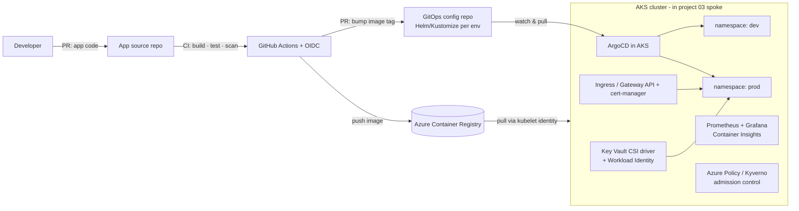

# 07 · GitOps AKS Platform with ArgoCD

> **Build order: #8** · Difficulty ⭐⭐⭐⭐ · ~3–4 weeks · Cost: ≈ $30–150/month while running (node VMs — stop/destroy the cluster when idle)

## The problem
Teams deploy to Kubernetes with `kubectl apply` from laptops: nobody knows what's actually running,
environments drift apart, and rollbacks are guesswork. Platform teams want a **self-service**,
auditable way to deploy many apps safely.

## What you'll build
An internal developer platform on **Azure Kubernetes Service (AKS)** where **Git is the single source of
truth**. ArgoCD continuously reconciles the cluster to match the Git repo: to deploy, you open a PR; to
roll back, you revert a commit.

## Skills & concepts you'll learn

### Kubernetes fundamentals (the big new skill — learn this first)
- **Architecture**: control plane (API server, etcd, scheduler, controllers) and worker nodes (kubelet, container runtime). AKS manages the control plane for you.
- **Objects**: Pod, ReplicaSet, **Deployment**, **Service** (ClusterIP / LoadBalancer), **Ingress**, ConfigMap, Secret, Namespace, StatefulSet, DaemonSet, Job/CronJob, PersistentVolumeClaim.
- **Declarative model & reconciliation loop**: you declare desired state; controllers continuously make reality match. *GitOps is this same idea extended to Git.*
- **Probes** (liveness/readiness/startup), **resource requests & limits**, **HPA** (Horizontal Pod Autoscaler), PodDisruptionBudgets.
- `kubectl` fluency: `get, describe, logs, exec, port-forward, apply, rollout status/undo, top`.
- Practise locally with **kind** or **minikube** before paying for AKS.

### Packaging
- **Helm**: charts, templates, `values.yaml`, releases.
- **Kustomize**: base + overlays (`dev`, `prod`) without templating.
- Know when you'd pick each (and that ArgoCD supports both).

### GitOps principles (OpenGitOps)
1. **Declarative** — the whole system is described declaratively.
2. **Versioned & immutable** — stored in Git; history = audit log.
3. **Pulled automatically** — an in-cluster agent pulls changes (no CI credentials to the cluster!).
4. **Continuously reconciled** — drift is detected and corrected.

### ArgoCD
- `Application` and `ApplicationSet` CRDs; **app-of-apps** pattern to bootstrap the whole platform.
- Sync policies: auto-sync, **self-heal**, prune; sync waves & hooks; health status.
- Projects (`AppProject`) and RBAC for multi-team tenancy; SSO with Entra ID.
- Promotion between environments (dev → prod) via PRs to the config repo.
- Image update automation (ArgoCD Image Updater or a CI step that opens a PR).
- Know the alternative: **Flux** (also available as the AKS GitOps extension).

### AKS specifics
- Node pools (system vs user), VM sizes, **cluster autoscaler**, spot node pools for cheap dev.
- Networking: **Azure CNI Overlay** vs kubenet; network policies; private cluster option.
- **Microsoft Entra Workload ID**: pods get an Azure identity through federated credentials (same OIDC idea as project 09!) — no secrets to access Key Vault, Storage, etc.
- **Key Vault Secrets Store CSI driver** for secrets.
- ACR integration (`AcrPull` role on the kubelet identity).
- Upgrades: Kubernetes version support window, node image upgrades, auto-upgrade channels.
- Ingress: **Application Routing add-on** (managed NGINX) or **Gateway API**; **cert-manager** + Let's Encrypt for TLS.

### Platform engineering & security
- Admission control: **Azure Policy for AKS** or **Kyverno/Gatekeeper** — e.g. deny privileged pods, require resource limits, only allow images from your ACR.
- Image scanning in CI (Trivy), image signing (cosign/Notation) as a stretch.
- Multi-tenancy with namespaces, quotas, RBAC.
- Observability: **Managed Prometheus + Managed Grafana** or kube-prometheus-stack; Container Insights; logs to Log Analytics (→ project 06/10).

## Build plan
1. **Local first**: kind cluster, deploy a sample app with plain manifests, then Helm, then Kustomize overlays.
2. Terraform: AKS (system + user node pool, autoscaler, workload identity + OIDC issuer enabled), ACR, Key Vault, Log Analytics. Ideally in a spoke of project 03.
3. Bootstrap ArgoCD with Helm via Terraform (or a one-off script), then **app-of-apps** so ArgoCD manages itself and the platform add-ons (ingress, cert-manager, monitoring, policy).
4. Config repo layout: `apps/<app>/base`, `apps/<app>/overlays/{dev,prod}`, `platform/…`.
5. App CI: build → test → Trivy scan → push to ACR → open PR bumping the tag in the config repo.
6. Prod promotion via PR with required review. Demo **rollback = `git revert`**.
7. Demo **drift self-heal**: `kubectl delete deployment` or `kubectl scale` manually → ArgoCD restores it.
8. Workload Identity demo: pod reads a secret from Key Vault without any credentials.
9. Dashboards (Grafana) + alerts.

## Cost hot-spots
- **Node VMs** are the cost. Use the Free control-plane tier, 1–2 small nodes (e.g. `Standard_B2s`/`D2s`), spot pools for dev, and `az aks stop` when not in use.
- Each `LoadBalancer` Service creates a public IP — use one ingress controller instead.
- Managed Grafana and Prometheus have their own pricing — OSS in-cluster is cheaper for a demo.

## Stretch goals
- **Progressive delivery** with Argo Rollouts (canary with automatic analysis on Prometheus metrics).
- **KEDA** event-driven autoscaling (scale on Service Bus queue length from project 04).
- **Backstage** developer portal with templates that scaffold a new app + ArgoCD application.
- Multi-cluster with ApplicationSets (dev cluster + prod cluster).
- Crossplane or ASO (Azure Service Operator) so teams request Azure resources from Kubernetes YAML.

## Interview talking points
- "Push vs pull deployments" — why the cluster pulling from Git is more secure (no cluster credentials in CI).
- How a rollback works (git revert → ArgoCD sync) and how drift is corrected.
- Workload Identity vs storing secrets in Kubernetes Secrets.
- How you'd onboard team #20 onto the platform in under an hour.
