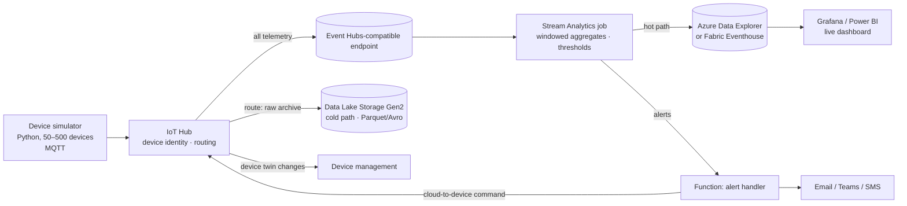

# 08 · Real-Time IoT Telemetry Pipeline

> **Build order: #6** · Difficulty ⭐⭐⭐ · lead cloud ~2 weeks · Azure cost: ≈ $5–80/month (Stream Analytics and ADX are the main costs — stop them when idle)

## The problem
Thousands of devices (sensors, machines, vehicles) send readings every few seconds. The business wants
live dashboards, instant alerts when something goes out of range ("freezer temperature > −10 °C"),
and cheap long-term storage for analytics.

## What you'll build
A pipeline that ingests telemetry from simulated devices, processes it in real time, alerts on
anomalies, and stores it in hot (fast query) and cold (cheap archive) paths — the **lambda-style hot/cold
path** architecture.



## Multi-cloud implementation

The diagram above is the **Azure reference implementation** (Azure is the lead cloud — see the [roadmap](../../ROADMAP.md#1-the-strategy-design-once-build-three-times)). Build it there first, then port it using the mapping below. Full service list: [multi-cloud service map](../../docs/multi-cloud-service-map.md).

| Component | AWS | Azure | GCP |
|---|---|---|---|
| Device gateway (MQTT) | **AWS IoT Core** | **IoT Hub** | ⚠️ *No native service* (IoT Core retired 2023) → **EMQX / Mosquitto** on GKE or a VM, bridged to Pub/Sub |
| Device identity | X.509 certificates + IoT policies | SAS keys / X.509 | Broker authentication (X.509 / JWT) |
| Device state | **Device Shadow** | **Device twin** | Your own (e.g. Firestore document per device) |
| Routing | IoT **rules** (SQL) | Message routing | Broker bridge rules |
| Stream | Kinesis Data Streams | Event Hubs | Pub/Sub |
| Stream processing | Managed Service for Apache Flink | Stream Analytics | **Dataflow** (Apache Beam) |
| Hot store | Timestream for InfluxDB / OpenSearch | Azure Data Explorer | **BigQuery** (streaming inserts) |
| Cold store | S3 + Athena | ADLS Gen2 | Cloud Storage + BigQuery external tables |
| Dashboards | Amazon Managed Grafana | Azure Managed Grafana | Grafana (self-hosted) / Looker Studio |

**Differences that matter**
- **GCP has no managed IoT gateway** — and that's your best interview story for this project: "I had to choose between a partner broker and running EMQX myself; here's the trade-off." It also shows why a portable MQTT layer reduces lock-in.
- **Windowing** looks different: Stream Analytics SQL, Flink SQL/Java, Beam pipelines (Python). Implement the same 1-minute tumbling-window average on all three and compare.
- Keep the **device simulator identical** — speak plain MQTT and change only the endpoint and certificates per cloud.
- **Cost:** Flink KPUs, Stream Analytics streaming units and Dataflow workers all bill while running. Stop or delete them after each test.

## Skills & concepts you'll learn

### IoT fundamentals
- Protocols: **MQTT** (lightweight pub/sub — the IoT standard), AMQP, HTTPS.
- **Device identity**: each device authenticates individually (SAS keys or X.509 certificates). Revoke one compromised device without touching the rest.
- **Device-to-cloud (D2C)** telemetry vs **cloud-to-device (C2D)** commands; **direct methods**.
- **Device twins**: JSON documents with *desired* (cloud sets) and *reported* (device reports) properties — e.g. set the reporting interval remotely.
- **Device Provisioning Service (DPS)**: zero-touch onboarding at scale.
- **IoT Hub message routing**: send messages to different endpoints based on properties/body.
- Know the landscape: IoT Hub (device-centric), Event Hubs (raw ingestion), Azure IoT Operations (edge/Kubernetes-based).

### Stream processing
- **Streams vs batches**; **event time vs processing time**; late-arriving and out-of-order events.
- **Windowing**: tumbling (fixed, non-overlapping), hopping (overlapping), sliding, session windows. Example — 1-minute average per device:
  ```sql
  SELECT deviceId, AVG(temperature) AS avgTemp, System.Timestamp() AS windowEnd
  INTO [adx-output]
  FROM [iothub-input] TIMESTAMP BY eventTime
  GROUP BY deviceId, TumblingWindow(minute, 1)
  ```
- Threshold and **anomaly detection** (Stream Analytics has built-in `AnomalyDetection_SpikeAndDip`).
- **Streaming units**, partitioning and parallelism; throughput vs cost.

### Event Hubs internals (also used by project 06/10)
- **Partitions** (unit of parallelism and ordering), **consumer groups** (independent readers), **checkpointing**, retention, throughput units.
- **Partition key** choice (deviceId) to keep a device's events in order.

### Time-series storage & analytics
- **Azure Data Explorer (ADX)** / **Fabric Real-Time Intelligence (Eventhouse)**: columnar, built for time-series and logs, queried with **KQL** (same language as Log Analytics — skills transfer to projects 06 and 10).
  ```kusto
  Telemetry
  | where Timestamp > ago(15m)
  | summarize avg(Temperature) by DeviceId, bin(Timestamp, 1m)
  | render timechart
  ```
- **Hot / warm / cold** data tiers; retention and caching policies.
- **Data lake** layout: partition folders by date (`/year=2026/month=11/day=01/`); file formats (**Parquet** for analytics, Avro for row-based ingestion).

### Visualisation
- **Azure Managed Grafana** or Grafana OSS with the ADX plugin, or Power BI with DirectQuery.
- Designing an operations dashboard: device health map, out-of-range devices, message rate.

## Build plan
1. Device simulator: Python + `azure-iot-device` SDK; N devices with realistic drift and occasional spikes/failures (dead device, stuck sensor).
2. Terraform: IoT Hub (free F1 or S1), DPS, Stream Analytics job, ADX (dev SKU) or Fabric trial, ADLS Gen2, Function app.
3. IoT Hub routes: all telemetry → built-in endpoint; raw archive → storage.
4. Stream Analytics: 1-minute aggregates → ADX; threshold breaches → Function.
5. Alert Function → notification + C2D command (e.g. "increase reporting rate").
6. Device twin: change desired `reportingIntervalSec` from the cloud, simulator obeys.
7. Dashboard + a KQL notebook of interesting queries. Scale the simulator from 50 → 500 devices and record throughput/latency.

## Cost hot-spots
- **Stream Analytics** bills per streaming-unit hour even when idle → **stop the job** when not testing.
- **ADX clusters** bill per hour — use the Dev/Test SKU, the free ADX cluster offering, or a Fabric trial, and stop when idle.
- IoT Hub F1 free tier is limited (8,000 messages/day) — enough for development with a low send rate.

## Stretch goals
- **IoT Edge**: run filtering/aggregation on the device side (container module).
- Predictive maintenance: train a simple model on the archived data.
- Replace Stream Analytics with an Azure Function or Spark Structured Streaming and compare.
- Digital twin model of a building with Azure Digital Twins.

## Interview talking points
- Hot vs cold path and why you need both.
- How you'd scale to 1 million devices (partitions, IoT Hub units, DPS, consumer groups).
- Handling late/out-of-order data (`TIMESTAMP BY`, late-arrival tolerance).
- Device security: per-device identity, X.509, revoking a device.
