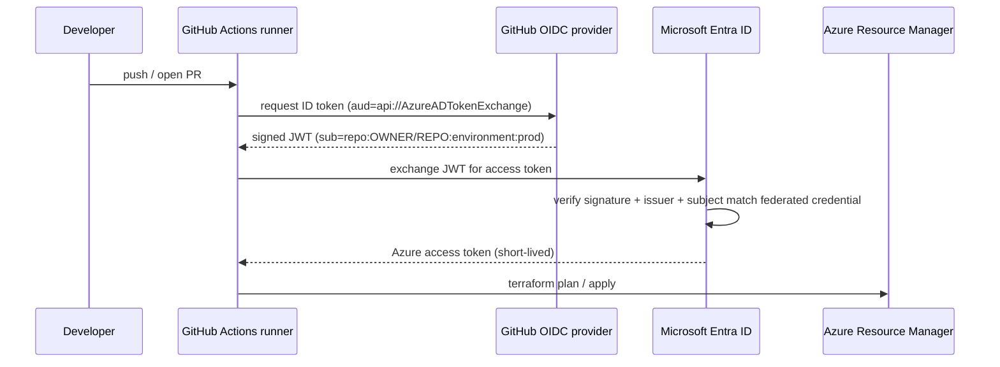

# 09 · Secrets-Free CI/CD with GitHub OIDC (AWS · Azure · GCP)

> **Build order: #1** · Difficulty ⭐⭐ · lead cloud ~1 week · Azure cost: ≈ $0–2/month (a storage account for Terraform state)

## The problem
The classic way to let a pipeline deploy to Azure is to create a service principal, generate a
**client secret**, and paste it into GitHub Secrets. That secret is long-lived, can leak through logs or forks,
has to be rotated, and anyone who has it can deploy from anywhere.

## What you'll build
A reusable GitHub Actions pipeline that deploys Terraform to Azure **with no stored credentials**.
GitHub proves its identity to Azure with a short-lived signed token (OIDC), and Azure swaps it for a
~1-hour access token. Every later project deploys through this pipeline.

## Multi-cloud implementation

The diagram above is the **Azure reference implementation** (Azure is the lead cloud — see the [roadmap](../../ROADMAP.md#1-the-strategy-design-once-build-three-times)). Build it there first, then port it using the mapping below. Full service list: [multi-cloud service map](../../docs/multi-cloud-service-map.md).

| Component | AWS | Azure | GCP |
|---|---|---|---|
| Trust GitHub's issuer | **IAM OIDC identity provider** for `token.actions.githubusercontent.com` | **Federated identity credential** on an app registration / user-assigned managed identity | **Workload Identity Pool** + OIDC **provider** |
| Restrict *which* repo/branch | Role **trust policy** conditions on `token.actions.githubusercontent.com:sub` (and `:aud = sts.amazonaws.com`) | Exact `subject` on the federated credential | **Attribute mapping** + **attribute condition** (e.g. `assertion.repository == 'Jaival/<repo>'`) |
| Exchange call | `sts:AssumeRoleWithWebIdentity` | Entra token endpoint (client assertion) | Security Token Service → direct resource access or **service account impersonation** |
| GitHub action | `aws-actions/configure-aws-credentials` (`role-to-assume`) | `azure/login` (`client-id`, `tenant-id`, `subscription-id`) | `google-github-actions/auth` (`workload_identity_provider`, `service_account`) |
| Terraform state | S3 backend (`use_lockfile = true`) | `azurerm` backend (blob lease) | `gcs` backend |
| Read-only "plan" identity | Role with `ReadOnlyAccess` | `Reader` | `roles/viewer` (or narrower) |

**Differences that matter**
- **AWS:** a trust policy that checks only `aud` and not `sub` lets **any GitHub repo in the world** assume your role. This is a real, common misconfiguration — show the correct condition in your write-up.
- **GCP:** the attribute condition is the security boundary; without a tight one, other repositories could use your pool. Know the difference between granting roles **directly to the federated principal** and **impersonating a service account**.
- **Azure:** subjects are exact matches (no wildcards on standard federated credentials), so you need one credential per branch/environment, or use the newer *flexible federated identity credentials* where available.

**Truly multi-cloud version:** one reusable workflow with a `cloud` input, plus a matrix job that
authenticates to all three clouds in one run, with **zero** entries in GitHub Secrets. This is the
backbone every later project deploys through.

## Skills & concepts you'll learn

### OpenID Connect (OIDC) & workload identity federation
- **OIDC** is an identity layer on top of OAuth 2.0. An *identity provider* issues a signed **JWT** (JSON Web Token) that says "this is who I am".
- GitHub runs its own OIDC provider (`https://token.actions.githubusercontent.com`). Each workflow run can request a token whose **claims** describe it: repository, branch, environment, workflow.
- In Entra ID you create a **federated identity credential** on an app registration (or user-assigned managed identity) that says: *"trust tokens from GitHub's issuer **only** if the subject is `repo:OWNER/REPO:environment:prod`."*
- The trust is in **who signed the token and what it claims**, not in a shared secret. Nothing to leak, nothing to rotate.
- Learn to decode a JWT (jwt.io) and read `iss`, `sub`, `aud`, `exp`.

### Subject claims — the security boundary
| Subject | Meaning |
|---|---|
| `repo:OWNER/REPO:ref:refs/heads/main` | Only runs on the `main` branch |
| `repo:OWNER/REPO:environment:prod` | Only jobs targeting the `prod` GitHub environment (add required reviewers!) |
| `repo:OWNER/REPO:pull_request` | PR runs — give this identity **read-only** (`Reader`) so PRs can `plan` but never `apply` |

Pattern to aim for: **two identities** — a read-only "plan" identity for PRs and a "deploy" identity locked to the `prod` environment.

> ⚠️ **The repository name is part of the subject.** `OWNER/REPO` must match the repo's name on GitHub exactly. If the repo is renamed after the trust is set up, every federated credential (Azure), role trust policy (AWS) and attribute condition (GCP) stops matching and logins fail — so settle the repo name **before** building this project.

### Terraform remote state in Azure Storage
- Backend `azurerm` storing state in a blob container; blob leases give **state locking**.
- Authenticate the backend with OIDC too (`use_oidc = true`, `use_azuread_auth = true`) so no storage keys are needed.
- Bootstrap problem: the state storage must exist before Terraform can use it. Phase 0 already solved this — [`foundations/02-state-backend/`](../../foundations/02-state-backend/) creates it on each cloud with its own local state. Reuse it; don't build a second one.

### GitHub Actions in depth
- `permissions: id-token: write, contents: read` (required for OIDC; also least-privilege for the `GITHUB_TOKEN`).
- `azure/login@v2` with `client-id`, `tenant-id`, `subscription-id` — these are **identifiers, not secrets** (store them as repository *variables*).
- Environments, required reviewers, concurrency groups (prevent two applies at once).
- Reusable workflows (`workflow_call`) so all 10 projects share one pipeline.
- Path filters: only run project 04's pipeline when `projects/04-*/**` changes.
- Posting the `terraform plan` output as a PR comment.

### Pipeline security (supply chain)
- Pin third-party actions to a commit SHA; use Dependabot for action updates.
- Static analysis: `tflint`, `checkov` / `trivy config`, `gitleaks` (secret scanning).
- Branch protection: require PR + passing checks before merging into `main`.

## Build plan
1. **Bootstrap**: already done in Phase 0 ([`foundations/02-state-backend/`](../../foundations/02-state-backend/)). Check the three state stores are deployed and note their `backend_config` outputs. The pipeline identities you create in step 2 will also need data access to them (Azure: `Storage Blob Data Contributor` on the state storage account).
2. **Identity**: app registration (or user-assigned managed identity) → federated credentials for `pull_request` and `environment:prod` → role assignments (`Reader` for plan, `Contributor` scoped to the project resource groups for deploy). *Do this in Terraform with the `azuread` provider for bonus points.*
3. **Workflow**: `fmt → validate → tflint → checkov → plan` on PR; `apply` on merge to `main` behind the `prod` environment.
4. **Reusable workflow**: `.github/workflows/terraform-reusable.yml` taking `working-directory` as input.
5. **Prove it**: show that GitHub Secrets is empty; show a fork PR **cannot** obtain a token that deploys.
6. **Docs**: diagram of the token exchange + a table of identities, subjects, roles and scopes.

## Cost hot-spots
Essentially free — one storage account. GitHub Actions minutes are free for public repos.

## Stretch goals
- Separate `dev` and `prod` subscriptions with different identities.
- Add **Infracost** to post the monthly cost delta of each PR.
- Drift detection: a nightly scheduled `terraform plan -detailed-exitcode` that opens an issue on drift.
- A weekly scheduled "canary" workflow that only logs in to all three clouds and runs an identity check (`aws sts get-caller-identity`, `az account show`, `gcloud auth list`) — it catches broken trust (expired setup, renamed repo) before a real deploy does.

## Interview talking points
- "Why is OIDC better than a client secret?" → no long-lived credential, scoped by subject claim, tokens expire in minutes, nothing to rotate.
- "How do you stop a PR from deploying to prod?" → separate read-only identity for `pull_request` subject; prod identity only trusts the protected `prod` environment.
- "How do you handle Terraform state securely?" → remote backend, Entra auth (no access keys), locking, versioning + soft delete on the container.
