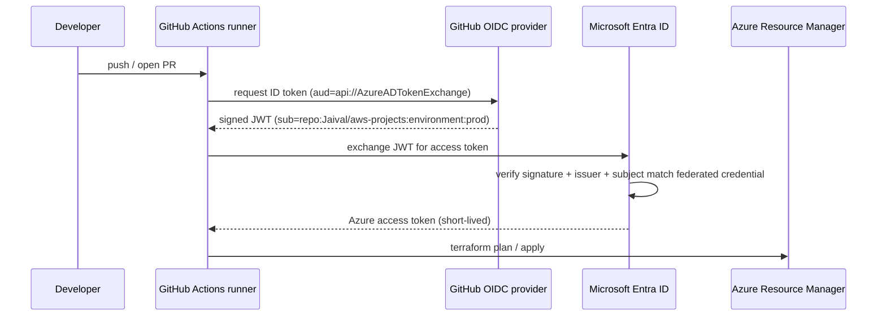

# 09 · Secrets-Free CI/CD with GitHub OIDC

> **Build order: #1** · Difficulty ⭐⭐ · ~1 week · Cost: ≈ $0–2/month (a storage account for Terraform state)

## The problem
The classic way to let a pipeline deploy to Azure is to create a service principal, generate a
**client secret**, and paste it into GitHub Secrets. That secret is long-lived, can leak through logs or forks,
has to be rotated, and anyone who has it can deploy from anywhere.

## What you'll build
A reusable GitHub Actions pipeline that deploys Terraform to Azure **with no stored credentials**.
GitHub proves its identity to Azure with a short-lived signed token (OIDC), and Azure swaps it for a
~1-hour access token. Every later project deploys through this pipeline.

## Skills & concepts you'll learn

### OpenID Connect (OIDC) & workload identity federation
- **OIDC** is an identity layer on top of OAuth 2.0. An *identity provider* issues a signed **JWT** (JSON Web Token) that says "this is who I am".
- GitHub runs its own OIDC provider (`https://token.actions.githubusercontent.com`). Each workflow run can request a token whose **claims** describe it: repository, branch, environment, workflow.
- In Entra ID you create a **federated identity credential** on an app registration (or user-assigned managed identity) that says: *"trust tokens from GitHub's issuer **only** if the subject is `repo:Jaival/aws-projects:environment:prod`."*
- The trust is in **who signed the token and what it claims**, not in a shared secret. Nothing to leak, nothing to rotate.
- Learn to decode a JWT (jwt.io) and read `iss`, `sub`, `aud`, `exp`.

### Subject claims — the security boundary
| Subject | Meaning |
|---|---|
| `repo:OWNER/REPO:ref:refs/heads/main` | Only runs on the `main` branch |
| `repo:OWNER/REPO:environment:prod` | Only jobs targeting the `prod` GitHub environment (add required reviewers!) |
| `repo:OWNER/REPO:pull_request` | PR runs — give this identity **read-only** (`Reader`) so PRs can `plan` but never `apply` |

Pattern to aim for: **two identities** — a read-only "plan" identity for PRs and a "deploy" identity locked to the `prod` environment.

### Terraform remote state in Azure Storage
- Backend `azurerm` storing state in a blob container; blob leases give **state locking**.
- Authenticate the backend with OIDC too (`use_oidc = true`, `use_azuread_auth = true`) so no storage keys are needed.
- Bootstrap problem: the state storage account must exist before Terraform can use it → create it once with a small script or a separate `bootstrap/` Terraform config.

### GitHub Actions in depth
- `permissions: id-token: write, contents: read` (required for OIDC; also least-privilege for the `GITHUB_TOKEN`).
- `azure/login@v2` with `client-id`, `tenant-id`, `subscription-id` — these are **identifiers, not secrets** (store them as repository *variables*).
- Environments, required reviewers, concurrency groups (prevent two applies at once).
- Reusable workflows (`workflow_call`) so all 10 projects share one pipeline.
- Path filters: only run project 04's pipeline when `projects/04-*/**` changes.
- Posting the `terraform plan` output as a PR comment.

### Pipeline security (supply chain)
- Pin third-party actions to a commit SHA; use Dependabot for action updates.
- Static analysis: `tflint`, `checkov` / `trivy config`, `gitleaks` (secret scanning).
- Branch protection: require PR + passing checks before merging into `main`.

## Build plan
1. **Bootstrap**: resource group + storage account + container for Terraform state (script in `bootstrap/`).
2. **Identity**: app registration (or user-assigned managed identity) → federated credentials for `pull_request` and `environment:prod` → role assignments (`Reader` for plan, `Contributor` scoped to the project resource groups for deploy). *Do this in Terraform with the `azuread` provider for bonus points.*
3. **Workflow**: `fmt → validate → tflint → checkov → plan` on PR; `apply` on merge to `main` behind the `prod` environment.
4. **Reusable workflow**: `.github/workflows/terraform-reusable.yml` taking `working-directory` as input.
5. **Prove it**: show that GitHub Secrets is empty; show a fork PR **cannot** obtain a token that deploys.
6. **Docs**: diagram of the token exchange + a table of identities, subjects, roles and scopes.

## Cost hot-spots
Essentially free — one storage account. GitHub Actions minutes are free for public repos.

## Stretch goals
- Separate `dev` and `prod` subscriptions with different identities.
- Add **Infracost** to post the monthly cost delta of each PR.
- Drift detection: a nightly scheduled `terraform plan -detailed-exitcode` that opens an issue on drift.
- Do the same for AWS (`aws-actions/configure-aws-credentials` with an IAM OIDC provider) — great talking point since your repo started as `aws-projects`.

## Interview talking points
- "Why is OIDC better than a client secret?" → no long-lived credential, scoped by subject claim, tokens expire in minutes, nothing to rotate.
- "How do you stop a PR from deploying to prod?" → separate read-only identity for `pull_request` subject; prod identity only trusts the protected `prod` environment.
- "How do you handle Terraform state securely?" → remote backend, Entra auth (no access keys), locking, versioning + soft delete on the container.
