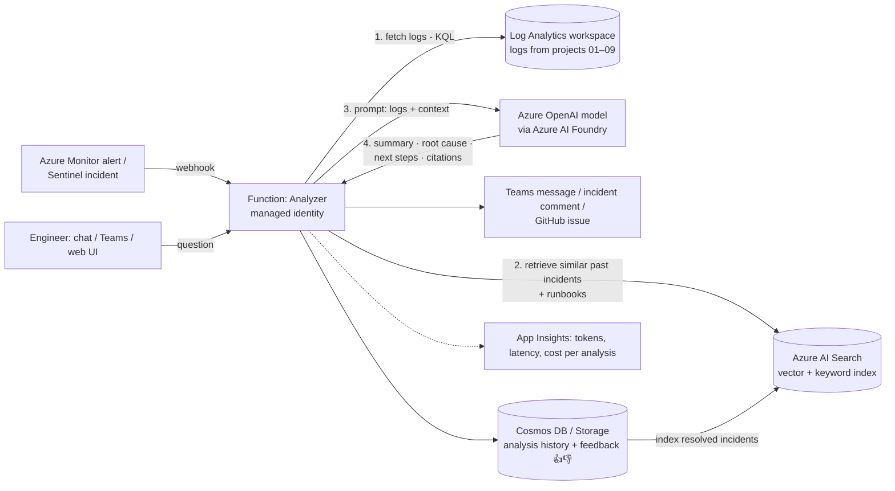

# 10 · AI-Powered Log Analyzer (Azure OpenAI · Bedrock · Vertex AI)

> **Build order: #10 (capstone)** · Difficulty ⭐⭐⭐⭐ · lead cloud ~2–3 weeks · Azure cost: ≈ $5–30/month (pay-per-token — set token limits)

## The problem
When something breaks, engineers spend most of the incident *reading*: thousands of log lines,
exceptions and alerts, trying to work out what happened. LLMs are good at summarising and explaining —
if you give them the right context and keep them grounded in real data.

## What you'll build
An assistant that watches the logs from all your previous projects. When an alert fires it gathers the
relevant logs with KQL, clusters similar errors, and asks an LLM for a **summary, likely root cause, and
suggested next steps**, citing the actual log lines. Engineers can also ask questions in plain English
("why did checkout fail last night?") and the tool turns them into KQL, runs them, and explains the
results.



## Multi-cloud implementation

The diagram above is the **Azure reference implementation** (Azure is the lead cloud — see the [roadmap](../../ROADMAP.md#1-the-strategy-design-once-build-three-times)). Build it there first, then port it using the mapping below. Full service list: [multi-cloud service map](../../docs/multi-cloud-service-map.md).

| Component | AWS | Azure | GCP |
|---|---|---|---|
| LLM platform | **Amazon Bedrock** | **Azure OpenAI** in Azure AI Foundry | **Vertex AI** |
| Auth (no keys) | IAM role | Managed identity | Service account |
| Log query API | CloudWatch Logs Insights (`StartQuery` / `GetQueryResults`) | Log Analytics Query API (KQL) | Cloud Logging API / BigQuery (SQL) |
| Managed RAG | Bedrock Knowledge Bases | Azure AI Search | Vertex AI RAG Engine |
| Safety filters | Bedrock Guardrails | Azure AI Content Safety | Vertex safety settings / Model Armor |
| Hosting | Lambda | Functions | Cloud Run |

**Design for three providers**
- Two small interfaces in `src/`: `LLMClient.complete(prompt, schema)` and `LogSource.query(time_range, filters)`, with one implementation per cloud. (A library like **LiteLLM** can cover the LLM side; writing a thin adapter yourself teaches more.)
- Some models are available on more than one platform (for example, Claude is on Bedrock, Vertex AI and Azure AI Foundry), so you can compare the *same* model across clouds as well as different models.
- Use one portable vector store (**PostgreSQL + pgvector**) or each cloud's managed RAG, and compare the two approaches.
- Natural language → query: the model must generate **KQL**, **Logs Insights QL** or **SQL** depending on the cloud. Give it the right schema and examples per cloud.

**The killer comparison:** run the **same evaluation set** (past incidents with known root causes)
through each provider and publish a table of accuracy, latency, and cost per analysis. Few portfolios have
real, measured LLM comparisons.

## Skills & concepts you'll learn

### LLM fundamentals (what an engineer needs, not a researcher)
- **Tokens**, context windows, input vs output pricing; why you can't just send 2 GB of logs.
- **Prompt engineering**: system prompt (role, rules, output format), few-shot examples, asking for **structured JSON output** (structured outputs / JSON schema), temperature (use low for analysis).
- **Hallucination** and **grounding**: instruct the model to only use provided logs and to cite line IDs; say "insufficient data" instead of guessing.
- **Function / tool calling**: let the model request "run this KQL query" and your code executes it (safely) — the basis of agents.
- Model choice: big reasoning models vs small fast/cheap models; use the cheap one for clustering/classification, the strong one for root-cause reasoning.

### Azure OpenAI / Azure AI Foundry
- Creating a resource, **model deployments** (deployment name ≠ model name), deployment types (standard, global, provisioned).
- Quotas & rate limits (tokens-per-minute), handling `429` with retries/backoff.
- **Entra ID auth with managed identity** (`Cognitive Services OpenAI User` role) — no API keys, consistent with every other project.
- **Content filtering / safety**, data privacy (your prompts aren't used to train models), private endpoints.
- SDK: `openai` Python package with Azure configuration (or Azure AI Foundry SDK).

### RAG — Retrieval-Augmented Generation
- **Embeddings**: turn text into vectors; similar meaning → nearby vectors.
- **Azure AI Search**: vector + keyword (**hybrid**) search, semantic ranker, chunking strategy.
- Index past incident reports (e.g. from project 06), runbooks (project 02 DR runbook!), and READMEs so the model can say "this looks like the 2026-10-12 DB connection pool incident — runbook step 3".

### Log pre-processing (the real engineering)
- You must **reduce** logs before the LLM sees them:
  - KQL to select the time window and failing components.
  - **Log pattern clustering** — KQL has `reduce` and `autocluster`/`basket` plugins that group similar messages:
    ```kusto
    AppExceptions
    | where TimeGenerated between (datetime(2026-11-01 10:00) .. datetime(2026-11-01 10:30))
    | summarize Count = count(), Sample = any(OuterMessage) by ProblemId
    | top 20 by Count
    ```
  - De-duplicate, truncate stack traces, keep counts + first/last timestamps.
- **PII / secret redaction** before sending anything to a model (emails, IPs if required, tokens) — a key security talking point.

### Natural language → KQL (safely)
- Give the model the **table schemas** and example queries; ask it to generate KQL.
- **Guardrails**: read-only identity (`Log Analytics Reader`), validate the query (allow-list tables, enforce a time range, `take` limit), timeouts. Never execute generated *write/admin* operations.

### Evaluating & operating an AI system (LLMOps)
- Build a small **evaluation set**: 10–20 past incidents with known root causes; score the analyzer's answers (accuracy, groundedness, citations). Re-run on every prompt change — prompts are code.
- Track **cost per analysis**, latency, token usage in App Insights.
- Human feedback (👍/👎) stored and reviewed.
- Prompt-injection awareness: log lines are *untrusted input* (an attacker could log "ignore previous instructions…") — delimit data clearly and never let model output trigger destructive actions.

## Build plan
1. Collect data: make sure projects 01/04/07 send logs to one Log Analytics workspace; generate failures with the chaos endpoints from project 01.
2. Terraform: Azure OpenAI (AI Foundry) + model deployments, AI Search, Function App (managed identity + RBAC), Cosmos DB, Key Vault (only if something truly needs a secret).
3. `analyze_incident(alert)`: KQL fetch → cluster/reduce → redact → prompt → structured JSON (summary, probable_cause, evidence[line ids], next_steps, confidence).
4. Wire Azure Monitor alerts / Sentinel incidents → Function → Teams/GitHub issue with the analysis.
5. RAG: index runbooks + resolved incidents in AI Search; include top 3 matches in the prompt.
6. Chat/Q&A mode with NL→KQL + guardrails (simple web UI with Streamlit, or a Teams bot).
7. Evaluation harness + dashboard of quality and cost.

## Cost hot-spots
- **Tokens**: cap input size (reduce logs first!), use a small model for pre-processing, set `max_tokens`.
- **Azure AI Search**: the Free tier is enough for a demo; paid tiers bill hourly.
- Azure OpenAI quota/availability varies by region — check before you deploy.

## Stretch goals
- An **agent** with tools: `query_logs`, `get_metrics`, `get_recent_deployments` (GitHub API), `search_runbooks` — the model decides which to call.
- Expose those tools as an **MCP server** so any AI assistant can use them.
- Automatic correlation with recent deployments ("errors started 3 minutes after commit abc123").
- Weekly "reliability digest" summarising all incidents.

## Interview talking points
- Why you don't send raw logs to the LLM (cost, context limits, noise, privacy) and how you reduced them.
- How you prevent hallucinations (grounding, citations, "I don't know", evaluation set).
- Security: managed identity, no keys, PII redaction, prompt-injection-aware design, read-only query identity.
- Measured results: "correct root cause in 14 of 18 test incidents; average cost $0.02 per analysis."
